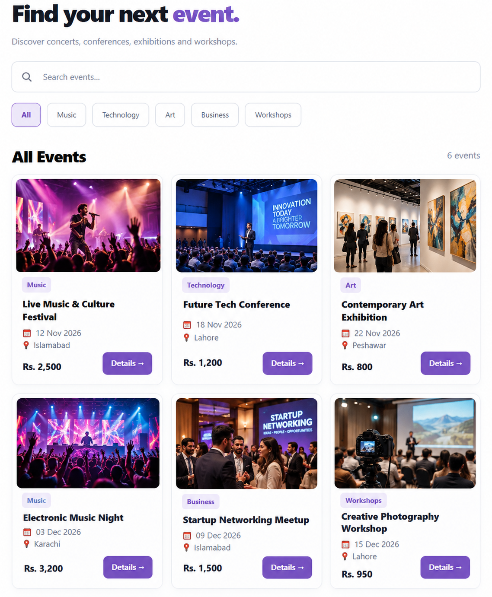

# EVibe — Event Management System

**University Semester Project · Spring 2025 · FAST NUCES, Peshawar Campus**

EVibe is a university semester project exploring an event-discovery, ticket-booking and management platform for attendees, organizers and administrators. The original project uses **PHP, MySQL, HTML, CSS and JavaScript**.



## Modern portfolio UI

A refreshed, responsive **light-theme frontend** with locally bundled event images (no external photo hosting required). Open **[`modern-preview/index.html`](modern-preview/index.html)** in a browser to explore:

- Event discovery, search and category filters
- Event details and ticket price information
- Ticket-booking demonstration with quantity/total
- Organizer event-submission demonstration
- Sign-in mockup and responsive navigation

**Important:** The modern frontend is a standalone demonstration with **illustrative event listings, dates and prices**. It is **not integrated** with the original PHP/MySQL backend. Demo forms do not create real bookings, users, payments or events. The screenshot and bundled images are illustrative visuals, not actual photographs of the listed events.

## Project organization

```text
EVibe-GitHub-Final/
├── README.md
├── .gitignore
├── MODERN_UI_GUIDE.md
├── modern-preview/
│   ├── index.html
│   ├── style.css
│   ├── app.js
│   └── assets/images/events/   # 6 local event images
├── docs/
│   ├── Evibe_Proposal.pdf
│   └── screenshots/event-listing-preview.png
├── database.sql
├── php/                     # Original PHP endpoints
└── templates/               # Original application and assets
```

## Run the frontend preview

1. Download or clone the repository.
2. Open `modern-preview/index.html` in Chrome, Edge or Firefox.
3. Explore the homepage, events, details, booking and hosting forms. **No server or internet connection is needed for the event images.**

## Run the original semester application

1. Install **XAMPP** (Apache, PHP and MySQL/MariaDB).
2. Copy the repository into the XAMPP `htdocs` folder.
3. Create a database and import `database.sql` via phpMyAdmin.
4. Adjust the credentials in `templates/config/database.php` for your local environment.
5. Check the original hard-coded paths (some reference `/evibe_database-update_with_php/`) and adjust to your local folder.
6. Start Apache and MySQL, then open the original application pages under `templates/`.

The original application's setup and all backend workflows have **not** been end-to-end tested in this refreshed package. Do not use sample/demo data or the original backend in production without a security review.

## Academic credits

**Project:** EVibe — Event Management System  
**Type:** University Semester Project  
**Institution:** FAST National University of Computer and Emerging Sciences, Peshawar Campus  
**Original project team:** Muhammad Adil (group leader), Muhammad Kaif, Mashaal Ishtiaq

See [the original proposal](docs/Evibe_Proposal.pdf) for the academic project scope and [the UI guide](MODERN_UI_GUIDE.md) for the distinction between the original implementation and modern preview.

## Notes on assets

The six event-card images are cropped from an AI-generated UI concept illustration supplied in the design iteration; they are **illustrative images**, not photographs of actual events. The preview intentionally uses local files to prevent broken external-image links.
